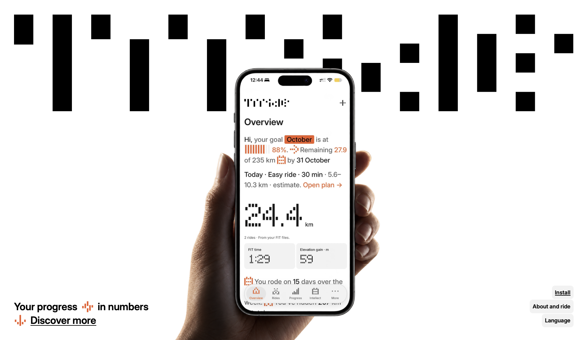

# and Ride

**Your progress in numbers.**

and Ride is a free cycling companion that turns FIT files from your bike computer into a clear picture of your rides, progress and training. Compare your rides, work towards a goal and find a rhythm that fits your everyday life.

[Visit and Ride](https://st-drafts.github.io/andride/) · [Install the app](https://st-drafts.github.io/andride/?install=1)



## What you can do

- **Bring your rides together.** Import `.FIT` files and explore distance, time, elevation, speed, heart rate, cadence and power when recorded by your device.
- **See your progress.** Compare rides and periods, follow monthly totals and discover your best power efforts.
- **Plan around your goal.** Set a distance goal and use Intellect for training and rest suggestions based on your ride history, how you feel and the weather.
- **Explore your routes.** View recorded rides on an interactive 3D route and inspect how your effort changes along the way.
- **Keep your history with you.** Export a backup and restore it when moving to another device.

## Get started

1. Open [and Ride](https://st-drafts.github.io/andride/) on your phone and follow the installation guide. On a computer, scan the installation QR code with your phone.
2. Launch the app from your home screen.
3. Import FIT files exported from your bike computer.
4. Explore your rides or set a goal to start planning.

The interface is available in 38 languages, with light and dark themes.

## Your rides stay on your device

No account is required. FIT files are processed in your browser, and your ride history is stored locally on your device. The installed app can open your saved history offline after its first successful load. Maps and weather use external services and need an internet connection for new data.

Use backups to keep a copy of your history or transfer it between devices.

## Run locally

Requires **Node.js 22 or newer**.

```sh
git clone https://github.com/st-drafts/andride.git
cd andride
npm run build
npm run dev
```

Open [the landing page](http://127.0.0.1:4173/andride/) or [the local app preview](http://127.0.0.1:4173/andride/?view=app). Rebuild after changing source files; the local server serves the `dist/` directory.

Run the automated checks with `npm test`.

## Credits and license

Created by [Nik Koslow](https://www.instagram.com/hoodbynik/) at [St.Drafts](https://www.instagram.com/mysaintdrafts/), a project about design for everyday life.

Licensed under the [MIT License with Commons Clause](LICENSE). See [third-party notices](THIRD_PARTY_NOTICES.txt) for software, fonts, maps and datasets used by the project.
